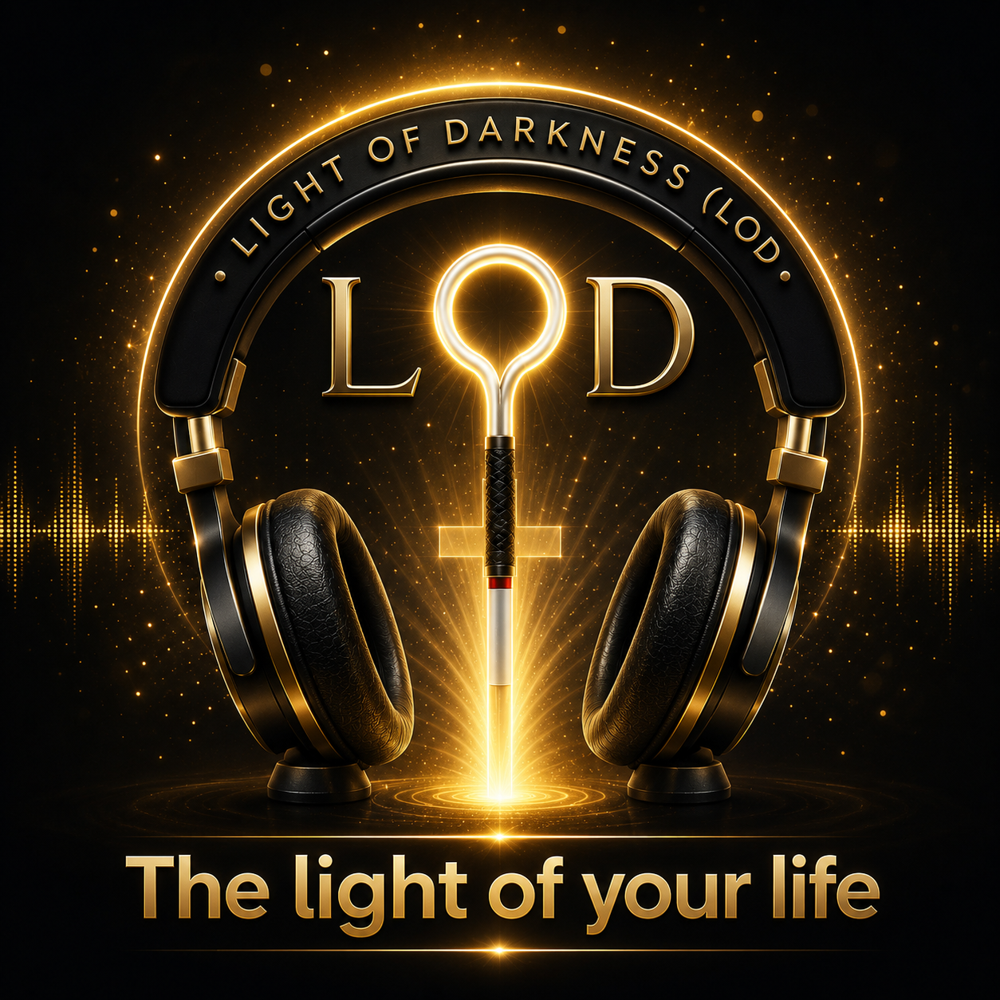

  

# LOD Music Player

**The light of your life.**

LOD Music Player is a music player and radio broadcasting tool for Android, made by **Light of Darkness-PH**. Play your own music, queue jingles and other station audio, and broadcast live to your Icecast or Shoutcast server, with your microphone, from your phone.

It is built to be comfortable to use with a screen reader (such as TalkBack) and for people with low vision: large touch targets, clear spoken labels, and text that follows your phone's font size.

> This repository contains the **official downloads** only. Get the latest version from the [Releases](../../releases/latest) page.

---

## Download and install

1. Open the [latest release](../../releases/latest).
2. Download the file named **LOD-Music-Player.apk**.
3. Open the downloaded file. If Android asks, allow your browser or file manager to install apps, then tap **Install**.
4. Open **LOD Music Player**.

**Requirements:** Android 8.0 or newer.

If you installed a test version of the app before, uninstall it first. Test versions use a different signature than official releases, and Android will not install one over the other.

### Updating

Inside the app, open **Settings**, then **Check for updates**. If a newer version is available, tap **Update Player**, then **Download Update**, and finally **Install update**. You can also download the newest release from this page and install it the same way.

---

## What it can do

### Music
- Start from a clean slate: the app reads **no music** until you import it.
- Import individual files (several at once) or a whole folder, from **internal storage or an SD card**.
- Songs are shown from their own details (artist, title, album, year) in the form `number: artist - title - album - year`.
- Browse by **Songs**, **Artist**, **Album**, **Genre** or the **Cue**.
- Queue songs with **Play next** and **Add to cue**, and reorder the cue.
- Keep separate **playlists**, for example one for each collection.
- **Crossfade**, **fade in**, **fade out** and **gapless playback**, with settings for each.
- Repeat, shuffle, and "stop after this track".

### Broadcast
- Save your **Icecast** and **Shoutcast** servers, edit them any time, and pick a bitrate from 60 to 320 kbps.
- The app works out by itself whether your server uses a secure connection.
- Connect to a server, or to **several servers at once**.
- **Auto-reconnect** if the connection drops.
- Talk over your music with the **microphone**, with **ducking** (the music gets quieter while you talk) and **Hear Myself** monitoring.
- Separate **Stream Volume** control for the music on the air.
- Show what is playing to your listeners, or write your **own custom metadata**.
- A **Logs** tab shows what the app is doing, and you can export it as a file.
- Saved passwords are stored **encrypted** on your phone.

### Stingers
- Import jingles, liners, ads and other station audio.
- Keep them on **card walls**, for example one per radio station.
- Queue them together with your songs. They hand over smoothly to and from the music, with an overlap you can set.

---

## Good to know

- Broadcasts are sent as **AAC**.
- Use **headphones** when the microphone is on, or the speaker's sound can echo into your broadcast.
- The app asks for the **microphone** only when you turn the microphone on, and for **internet** only to broadcast and to check for updates.
- LOD Music Player has no ads and does not need an account.

---

## Help and contact

Questions, problems or ideas? We would love to hear from you.

- Email: [lighlod@gmail.com](mailto:lighlod@gmail.com)
- Telegram: [Join our group](https://t.me/+pP6H6xDHmLNkZmI1)

When you report a problem, please tell us your phone model, your Android version, and the app version (in **Settings**, under **About**). If it happened while broadcasting, the **Logs** tab can be exported as a file, and sending it helps us a lot.

---

## License

Copyright (c) 2026 Light of Darkness-PH. All rights reserved.

LOD Music Player is proprietary software. Copying, modifying, redistributing or reverse engineering it is not allowed without the written permission of the copyright holder. The full license text is also inside the app, under **Settings**, then **License**.
